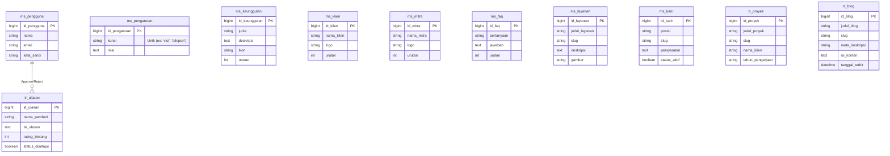

# Dokumentasi Database & ERD
**Proyek:** Website Company Profile Winmulyautama (WMU)
**Tech Stack:** Laravel + MySQL

---

## 1. Pembagian Tipe Data (Master vs Transaksi)

Untuk menjaga kerapian arsitektur database, tabel dibagi menjadi dua kelompok besar menggunakan *prefix*:
1. **Data Master (`ms_`)**: Berisi data referensi atau pengaturan dasar yang jarang berubah secara drastis (contoh: daftar klien, daftar layanan, pengaturan website).
2. **Data Transaksi (`tr_`)**: Berisi data yang dinamis, bertambah seiring waktu, atau merupakan hasil interaksi (contoh: artikel blog, portofolio proyek, ulasan yang masuk).

---

## 2. Entity Relationship Diagram (ERD)



---

## 3. Struktur Tabel Database (Data Dictionary)

Berikut rincian seluruh tabel menggunakan *prefix* dan kolom bahasa Indonesia, dengan standar *audit trail* (tracking).

### Standar Kolom Tracking (Berlaku di Semua Tabel)
Setiap tabel wajib memiliki 4 kolom ini di bagian akhir untuk kebutuhan *audit* (tracking siapa yang input/update dan kapan):
- `rec_datecreated` (TIMESTAMP) : Waktu data dibuat.
- `rec_dateupdate` (TIMESTAMP) : Waktu data terakhir diubah.
- `rec_usercreated` (VARCHAR/BIGINT) : User (Admin) yang membuat data.
- `rec_userupdate` (VARCHAR/BIGINT) : User (Admin) yang terakhir mengubah data.

---

### A. KELOMPOK DATA MASTER (`ms_`)

#### Tabel `ms_pengguna` (Akses Admin)
| Kolom | Tipe Data | Keterangan |
| :--- | :--- | :--- |
| `id_pengguna` | BIGINT (PK) | Auto Increment |
| `nama` | VARCHAR(255) | Nama Admin |
| `email` | VARCHAR(255) | Email untuk login (Unik) |
| `kata_sandi` | VARCHAR(255) | Password (Hashed bcrypt) |
| `remember_token` | VARCHAR(100) | Token sesi login bawaan Laravel |
| `rec_datecreated` | TIMESTAMP | Standar Audit |
| `rec_dateupdate` | TIMESTAMP | Standar Audit |
| `rec_usercreated` | VARCHAR(50) | Standar Audit |
| `rec_userupdate` | VARCHAR(50) | Standar Audit |

#### Tabel `ms_pengaturan` (Pengaturan Global & Footer)
*Menggunakan konsep Key-Value Pair.*
| Kolom | Tipe Data | Keterangan |
| :--- | :--- | :--- |
| `id_pengaturan` | BIGINT (PK) | Auto Increment |
| `kunci` | VARCHAR(100) | Kunci unik (contoh: `nama_pt`, `telepon`, `wa_number`, `visi`) |
| `nilai` | TEXT | Isi / nilai dari key tersebut. |
| `rec_datecreated` | TIMESTAMP | Standar Audit |
| `rec_dateupdate` | TIMESTAMP | Standar Audit |
| `rec_usercreated` | VARCHAR(50) | Standar Audit |
| `rec_userupdate` | VARCHAR(50) | Standar Audit |

#### Tabel `ms_keunggulan` (Keunggulan / Nilai Tambah)
| Kolom | Tipe Data | Keterangan |
| :--- | :--- | :--- |
| `id_keunggulan` | BIGINT (PK) | Auto Increment |
| `judul` | VARCHAR(255) | Judul Poin Keunggulan |
| `deskripsi` | TEXT | Penjelasan detail |
| `ikon` | VARCHAR(255) | Path file gambar/icon (opsional) |
| `urutan` | INT | Menentukan posisi urutan tampil |
| `rec_datecreated` | TIMESTAMP | Standar Audit |
| `rec_dateupdate` | TIMESTAMP | Standar Audit |
| `rec_usercreated` | VARCHAR(50) | Standar Audit |
| `rec_userupdate` | VARCHAR(50) | Standar Audit |

#### Tabel `ms_klien` (Daftar Pengguna Jasa / Klien)
| Kolom | Tipe Data | Keterangan |
| :--- | :--- | :--- |
| `id_klien` | BIGINT (PK) | Auto Increment |
| `nama_klien` | VARCHAR(255) | Nama Perusahaan Klien |
| `logo` | VARCHAR(255) | Path file gambar logo |
| `urutan` | INT | Posisi urutan tampil logo |
| `rec_datecreated` | TIMESTAMP | Standar Audit |
| `rec_dateupdate` | TIMESTAMP | Standar Audit |
| `rec_usercreated` | VARCHAR(50) | Standar Audit |
| `rec_userupdate` | VARCHAR(50) | Standar Audit |

#### Tabel `ms_mitra` (Daftar Vendor/Partner Strategis)
| Kolom | Tipe Data | Keterangan |
| :--- | :--- | :--- |
| `id_mitra` | BIGINT (PK) | Auto Increment |
| `nama_mitra` | VARCHAR(255) | Nama Perusahaan Partner |
| `logo` | VARCHAR(255) | Path file gambar logo |
| `urutan` | INT | Posisi urutan tampil logo |
| `rec_datecreated` | TIMESTAMP | Standar Audit |
| `rec_dateupdate` | TIMESTAMP | Standar Audit |
| `rec_usercreated` | VARCHAR(50) | Standar Audit |
| `rec_userupdate` | VARCHAR(50) | Standar Audit |

#### Tabel `ms_faq` (Pertanyaan Umum)
| Kolom | Tipe Data | Keterangan |
| :--- | :--- | :--- |
| `id_faq` | BIGINT (PK) | Auto Increment |
| `pertanyaan` | VARCHAR(500) | Teks pertanyaan |
| `jawaban` | TEXT | Teks jawaban |
| `urutan` | INT | Posisi urutan tampil |
| `rec_datecreated` | TIMESTAMP | Standar Audit |
| `rec_dateupdate` | TIMESTAMP | Standar Audit |
| `rec_usercreated` | VARCHAR(50) | Standar Audit |
| `rec_userupdate` | VARCHAR(50) | Standar Audit |

#### Tabel `ms_layanan` (Daftar Layanan Perusahaan)
| Kolom | Tipe Data | Keterangan |
| :--- | :--- | :--- |
| `id_layanan` | BIGINT (PK) | Auto Increment |
| `judul_layanan` | VARCHAR(255) | Nama layanan |
| `slug` | VARCHAR(255) | Teks SEO-Friendly untuk URL |
| `deskripsi` | TEXT | Penjelasan layanan |
| `gambar` | VARCHAR(255) | Path file gambar layanan |
| `rec_datecreated` | TIMESTAMP | Standar Audit |
| `rec_dateupdate` | TIMESTAMP | Standar Audit |
| `rec_usercreated` | VARCHAR(50) | Standar Audit |
| `rec_userupdate` | VARCHAR(50) | Standar Audit |

#### Tabel `ms_karir` (Lowongan Pekerjaan)
| Kolom | Tipe Data | Keterangan |
| :--- | :--- | :--- |
| `id_karir` | BIGINT (PK) | Auto Increment |
| `posisi` | VARCHAR(255) | Nama Posisi / Jabatan |
| `slug` | VARCHAR(255) | Teks SEO-Friendly untuk URL |
| `persyaratan` | TEXT | Detail kualifikasi |
| `status_aktif` | BOOLEAN | Apakah lowongan masih buka? |
| `rec_datecreated` | TIMESTAMP | Standar Audit |
| `rec_dateupdate` | TIMESTAMP | Standar Audit |
| `rec_usercreated` | VARCHAR(50) | Standar Audit |
| `rec_userupdate` | VARCHAR(50) | Standar Audit |

---

### B. KELOMPOK DATA TRANSAKSI (`tr_`)

#### Tabel `tr_ulasan` (Testimoni dari Klien)
| Kolom | Tipe Data | Keterangan |
| :--- | :--- | :--- |
| `id_ulasan` | BIGINT (PK) | Auto Increment |
| `nama_pemberi` | VARCHAR(255) | Nama klien yang mereview |
| `isi_ulasan` | TEXT | Teks testimoni |
| `rating_bintang` | TINYINT | Rating bintang (1 sampai 5) |
| `status_disetujui` | BOOLEAN | Default: `false` (0). Jika `true` (1), maka tampil di web. |
| `rec_datecreated` | TIMESTAMP | Standar Audit |
| `rec_dateupdate` | TIMESTAMP | Standar Audit |
| `rec_usercreated` | VARCHAR(50) | Standar Audit |
| `rec_userupdate` | VARCHAR(50) | Standar Audit |

#### Tabel `tr_proyek` (Portofolio Proyek / Studi Kasus)
| Kolom | Tipe Data | Keterangan |
| :--- | :--- | :--- |
| `id_proyek` | BIGINT (PK) | Auto Increment |
| `judul_proyek` | VARCHAR(255) | Judul/nama proyek |
| `slug` | VARCHAR(255) | Teks SEO-Friendly untuk URL proyek |
| `nama_klien` | VARCHAR(255) | Klien dari proyek tersebut |
| `tahun_pengerjaan`| VARCHAR(4) | Tahun proyek selesai |
| `rec_datecreated` | TIMESTAMP | Standar Audit |
| `rec_dateupdate` | TIMESTAMP | Standar Audit |
| `rec_usercreated` | VARCHAR(50) | Standar Audit |
| `rec_userupdate` | VARCHAR(50) | Standar Audit |

#### Tabel `tr_blog` (Artikel / Berita)
| Kolom | Tipe Data | Keterangan |
| :--- | :--- | :--- |
| `id_blog` | BIGINT (PK) | Auto Increment |
| `judul_blog` | VARCHAR(255) | Judul artikel |
| `slug` | VARCHAR(255) | Teks SEO-Friendly untuk URL blog |
| `meta_deskripsi` | VARCHAR(160) | Deskripsi khusus untuk tampil di Google |
| `isi_konten` | TEXT | Konten lengkap blog (Rich Text) |
| `tanggal_terbit` | DATETIME | Waktu publikasi artikel |
| `rec_datecreated` | TIMESTAMP | Standar Audit |
| `rec_dateupdate` | TIMESTAMP | Standar Audit |
| `rec_usercreated` | VARCHAR(50) | Standar Audit |
| `rec_userupdate` | VARCHAR(50) | Standar Audit |

---

> [!WARNING]
> **Catatan Penting Untuk Integrasi Laravel:**
> 1. Karena kita menggunakan penamaan kolom Timestamp kustom, di dalam Model Laravel kita harus menambahkan:
>    ```php
>    const CREATED_AT = 'rec_datecreated';
>    const UPDATED_AT = 'rec_dateupdate';
>    ```
> 2. Untuk kolom `rec_usercreated` dan `rec_userupdate`, Anda bisa mengaturnya secara otomatis berjalan di *background* menggunakan fitur **Model Observers** atau **Model Events** (`creating` dan `updating`) di Laravel agar admin tidak perlu input manual, sistem akan otomatis membaca ID user yang sedang login (`Auth::id()`).
